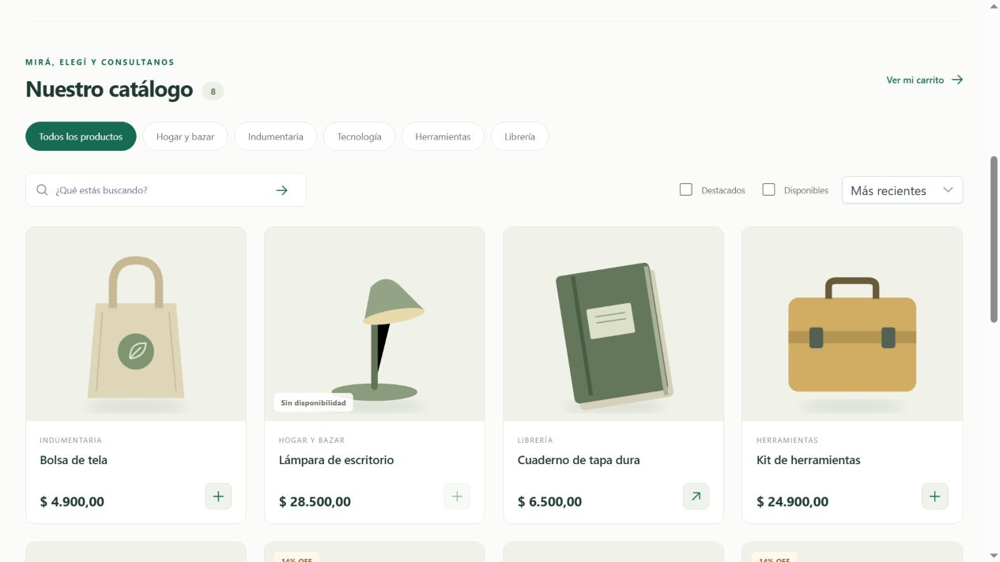

# Catálogo y pedidos por WhatsApp

Tienda web para comercios. El cliente busca productos, elige variantes y arma un carrito. La aplicación valida precios y disponibilidad y prepara el mensaje de WhatsApp que el cliente confirma desde su teléfono o navegador.

El comercio administra productos, categorías, fotos y datos de contacto desde un panel con login. Cada comercio tiene su propia instalación.



**Tecnologías** · Java 21, Spring Boot, Angular, PrimeNG, PostgreSQL y Docker.

## Probar en local

Con Docker y Compose instalados:

```powershell
git clone https://github.com/cesararamayo3068/catalogo-whatsapp.git
cd catalogo-whatsapp
Copy-Item .env.example .env
# Editá .env con contraseñas propias para DB_PASSWORD y ADMIN_PASSWORD.
docker compose up --build -d
```

- [Tienda](http://localhost:14202) con productos de ejemplo.
- [Panel](http://localhost:14202/admin) con el usuario y la contraseña de `ADMIN_USERNAME` y `ADMIN_PASSWORD`.
- Para probar un pedido completo, configurá el número del comercio en **Mi negocio**.

## Documentación

- [Configuración, API y despliegue](docs/OPERACION.md)
- [Arquitectura](docs/ARCHITECTURE.md)
- [Publicar una demo](docs/DESPLIEGUE.md)
